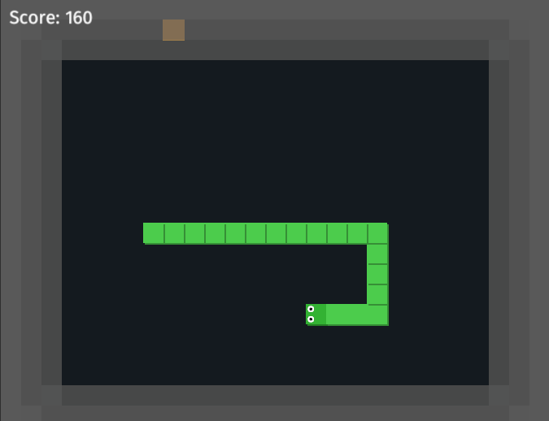

# 🐍 Rust Snake Game

A classic Snake game written in Rust using the Piston Window library. The game offers smooth gameplay with animated visual effects and charming details.



## ✨ Features
- **Core Gameplay**
  - Classic snake mechanics with growth system
  - Collision detection (walls and self)
  - Score tracking

- **Visual Enhancements**
  - Directional snake eyes 👀
  - Animated flickering tongue 👅
  - Pulsating food effect 💫
  - Multi-layered borders

- **Technical Features**
  - VSync-enabled smooth rendering
  - Responsive controls
  - Automatic game restart

## 🎮 Controls
| Key        | Action               |
|------------|----------------------|
| Arrow Keys | Change snake direction |
| Space      | Restart game         |
| ESC        | Exit game            |

## 🛠️ Requirements

- Rust
- Cargo

## 📦 Installation and Running

1. Clone the repository:
```bash
git clone https://github.com/Xeyo-Developer/Rust-SnakeGame/
cd Rust-SnakeGame
```

2. Run the game:
```bash
cargo run
```

## 🎯 Game Rules

1. **Goal**: Collect food (golden squares) to grow the snake
2. **Game Over**: Hit the wall or your own tail
3. **Restart**: Game automatically restarts after 1 second from game over
4. **Movement**: Snake moves automatically, you only control the direction

## 🏗️ Architecture

The project consists of five main modules:

### `main.rs`
- Application entry point
- Game window configuration (27x22 blocks)
- Main game loop handling events and rendering

### `game.rs`
- Game logic and state management
- Collision handling and win/lose condition checking
- Food generation in random positions
- Snake movement timer (200ms per move)

### `snake.rs`
- Snake implementation as a linked list of blocks
- Movement and direction handling
- Tongue animation with random timing
- Self-collision detection

### `drawing.rs`
- All graphics rendering functions
- Game coordinates to pixel conversion
- Drawing blocks, eyes, tongue, and borders
- Visual effects (gradients, shadows)

## 🎨 Visual Details

- **Block size**: 25x25 pixels
- **Board**: 27x22 blocks (675x550 pixels)
- **Colors**:
  - Background: Dark blue `[0.08, 0.10, 0.12, 1.0]`
  - Snake head: Dark green `[0.20, 0.70, 0.20, 1.0]`
  - Snake body: Light green `[0.30, 0.80, 0.30, 1.0]`
  - Food: Golden `[0.96, 0.71, 0.20, 1.0]`
- **Effects**:
  - Block shadows for depth
  - Pulsating food
  - Animated tongue (red)
  - White eyes with black pupils

## 🔧 Dependencies

```toml
[dependencies]
piston_window = "0.146.0"
rand = "0.9"
```

## 📄 License

This project is licensed under the [MIT License](https://mit-license.org/) - see the [LICENSE](https://github.com/Xeyo-Developer/Rust-SnakeGame/blob/main/LICENSE) file for details.
